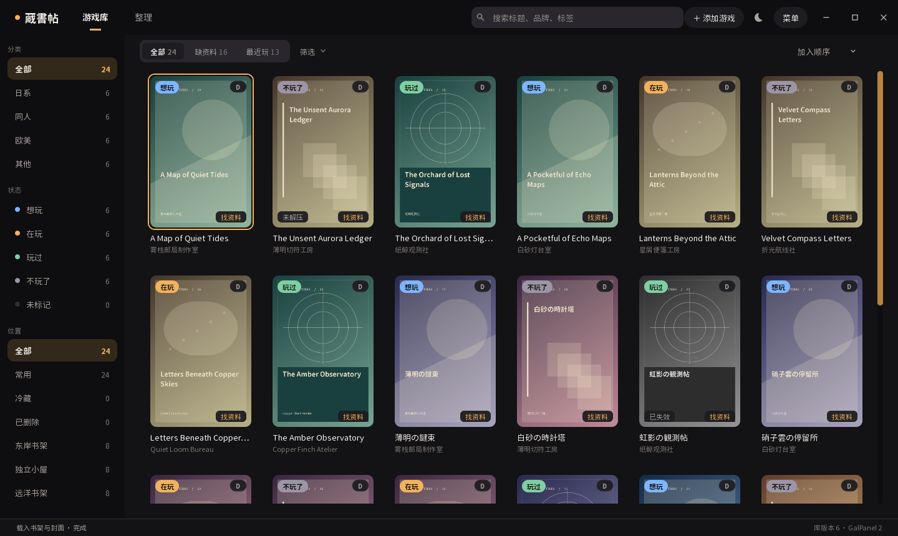
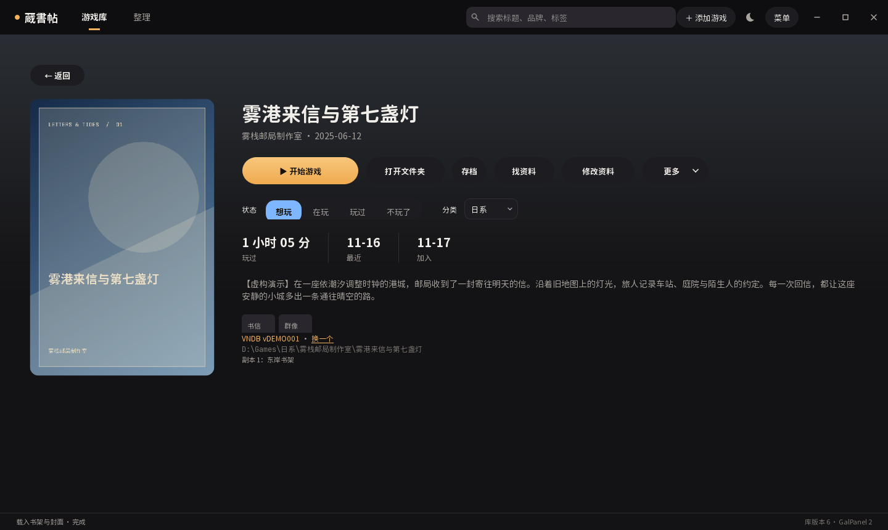
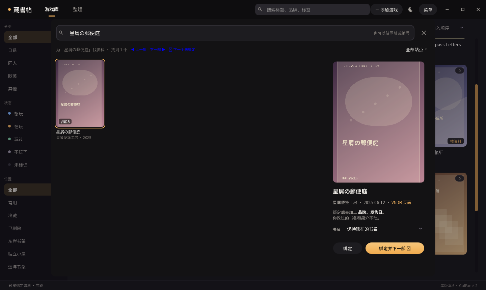
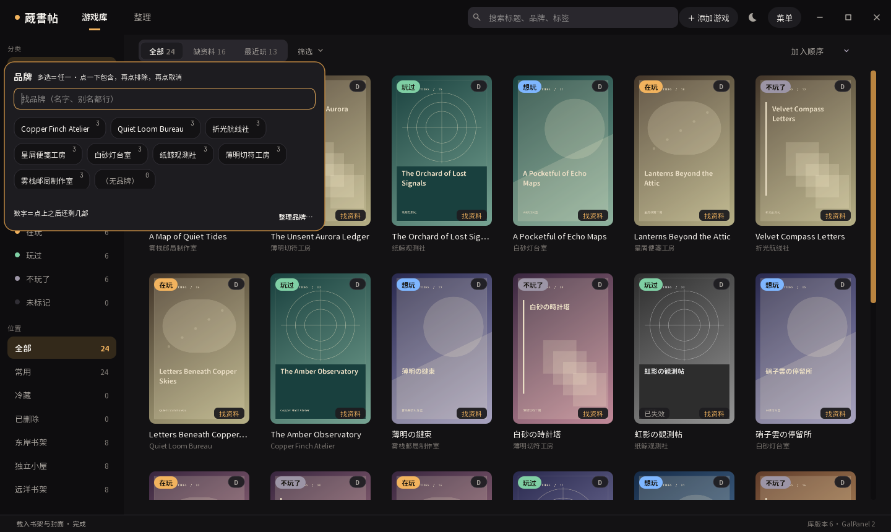
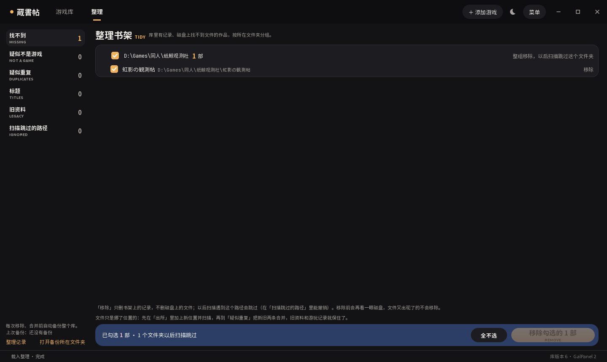
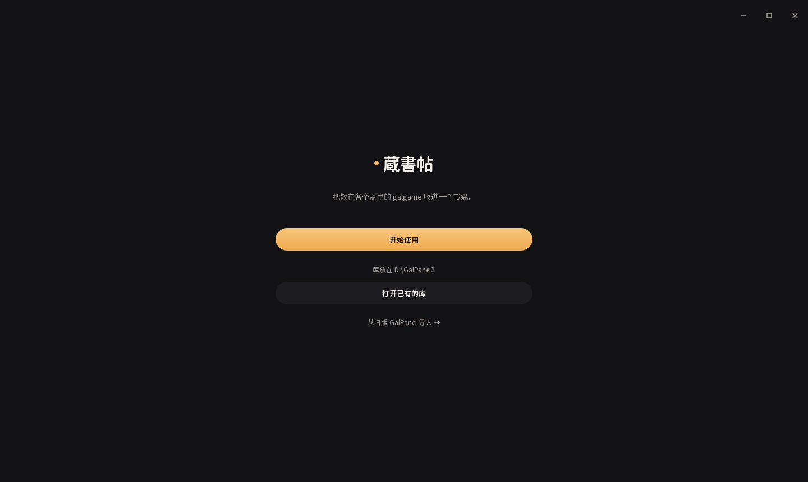

# GalPanel2 · 蔵書帖

A Windows desktop library manager for locally owned visual novels and games, with metadata binding and safe JSON CLI / MCP control for AI agents. [中文说明](README.md).



**[Deployment, upgrades and AI setup](docs/DEPLOY.md)** (Chinese) · [Latest release](https://github.com/st666xiao/galpanel2-oss/releases/latest)

The interface is primarily Chinese. No games are included. Titles, studios, metadata IDs and covers in the demo screenshots are fictional.

## Features

### A visual library

Browse a poster wall, open game details, and check summaries, studios, tags, file locations and play history. The default media theme is dark; day and night themes are also available.



### Multiple folders

Add folders across disks under 「出所」 (sources). Scan, review the proposed entries, then commit. A work can have multiple file copies. Removing a source preserves its existing works and copy records.

### Metadata binding

「找资料」 searches VNDB, DLsite, Bangumi, Steam and F95zone. Review candidates before binding titles, studios, summaries, covers and source tags. Available fields vary; verify the edition yourself.



### Categories, status and filters

Categories are Japanese, doujin, Western and other. Play states are want to play, playing, played and dropped. Filter by studio, tags and file state.



### Cold storage and tidying

「冷藏到机械盘…」 moves infrequently played copies to another location. Check the destination in settings first; the default example is `D:\ColdStorage\Games`. Folder organization previews its plan before moving files. 「整理」 checks missing records and possible duplicates, backing up the library before removal or merging.



### Saves and AI tools

The detail page's 「存档」 offers 2DFan save lookup and import. Confirm the destination before applying saves. Save backups are separate from database backups.

The source CLI includes an AI identification pipeline for unclear folder names and identification reports. JSON CLI and MCP let AI clients query the library, inspect candidates and preview or apply metadata changes.

## Quick start

Requires Windows 10/11 x64. Packaged builds include the runtime; Python is not required.

1. **Recommended: installer.** Download `GalPanel2-Setup-<version>.exe` from [Releases](https://github.com/st666xiao/galpanel2-oss/releases/latest) and run it. It installs for the current user at `%LOCALAPPDATA%\Programs\GalPanel2`, with a Start menu shortcut and an optional desktop shortcut. No administrator access is needed.
2. **One PowerShell command.** Fetch the latest stable release, verify its SHA256, then install silently:

   ```powershell
   irm https://raw.githubusercontent.com/st666xiao/galpanel2-oss/main/install.ps1 | iex
   ```

3. **Portable.** Download `GalPanel2-<version>-win64.zip`, extract the entire folder and run `GalPanel2.exe`. Keep `_internal` and both console EXEs together. Alternatively download `install.ps1` and run `.\install.ps1 -Portable -Directory D:\Apps\GalPanel2`; the destination must be absent or empty.
4. **Source.** Install Python 3.13 and Git, then follow the [source deployment commands](docs/DEPLOY.md#方式-d源码部署).

Assets become available when the release is published. The script stops if an asset or checksum is missing, or verification fails. It prints GUI, agent and MCP paths and does not launch the GUI automatically.



For upgrades, close the GUI and AI tools, back up your library and covers, then run the newer Setup over the existing installation. Keep libraries outside the program folder. Uninstall through Windows Settings; external libraries and `%APPDATA%\GalPanel2` settings remain. Portable builds use that same settings location. If SmartScreen blocks a download, verify its official source before choosing More info → Run anyway, where device policy permits it.

The [deployment guide](docs/DEPLOY.md) covers portable upgrades, shortcuts, backups, troubleshooting and installed/portable/source MCP configurations. Use absolute executable paths in MCP clients; do not assume they expand `%LOCALAPPDATA%`.

## First use

1. Click 「开始使用」 to create a library at the default location, or 「打开已有的库」 to open an existing one.
2. In 「出所」, choose 「添加目录」 and select a game folder.
3. Select that source and click 「扫描这个目录」. Review new and same-name entries, then click 「入库 N 部」 to commit the selected number. Preparing a scan does not commit it.
4. Open a work and choose 「找资料」. Check the candidate and binding preview before confirming. 「全部找资料」 starts batch lookup.
5. Set categories and play status, then check 「整理」. Carefully review paths when moving or deleting game files.

## Data and backups

The library is a `.galdb` SQLite file. A new default library goes to `D:\GalPanel2\library.galdb` when D: exists, otherwise to the settings directory. Covers live beside it in `<library>.galdb.covers/`.

Close the GUI and writing tools, then back up **both the database and covers directory**. Games and saves remain in their original folders and require separate backups. Pending batch candidates may be in `<library>.m2queue.json`; preserve this too if needed. Agent writes create `<library>.agent-<UTC>.bak` backups beside the database.

Settings are in `%APPDATA%\GalPanel2\settings.json`; the GUI Bangumi token is in `bangumi_token.txt` in that directory. Keep credentials private. `GALPANEL2_SETTINGS_DIR` overrides the settings directory and `GALPANEL2_DEFAULT_LIBRARY` overrides the default library path.

## Network and privacy

Local browsing works offline. Metadata search, record/cover retrieval and save lookup contact the relevant sites. Sites may rate-limit, require access permissions or refuse requests. Some source metadata may contain adult content.

AI identification sends titles and collected local identification hints to the service or command you configure. Review the hints and configuration first. External commands run with your user permissions and manage their own logs and credentials.

## AI identification configuration

There is no default model or external tool. Configure an OpenAI-compatible endpoint:

```powershell
$env:GALPANEL2_AI_BASE_URL="https://api.example.com/v1"
$env:GALPANEL2_AI_MODEL="your-model"
$env:GALPANEL2_AI_API_KEY="your-key"
python -m galpanel2.identify --help
```

The HTTP backend uses `POST {base_url}/chat/completions`. Remote endpoints require HTTPS; HTTP is restricted to localhost, 127.0.0.1 and [::1]. Alternatively save this as `ai.json` and pass `--ai-config ai.json` to the identification command:

```json
{"backend":"openai","base_url":"https://api.example.com/v1","model":"your-model","api_key_env":"GALPANEL2_AI_API_KEY"}
```

Only the environment variable name belongs in configuration. Literal `api_key`, `key` and `token` fields are rejected. An explicitly requested missing configuration file is an error. HTTP credentials are redacted from identification logs/results and are not forwarded through redirects.

Trusted external commands are also supported:

```json
{"backend":"command","argv":["your-ai-tool","--prompt","{prompt}","--output","{out}"],"mode":"file","timeout":300}
```

File mode passes a prompt file and reads JSON from `{out}` (or stdout if the file is empty). Stdin mode reads the prompt from stdin and returns JSON on stdout. `{dir}` and `{timeout}` placeholders are also available. Identification is a source CLI feature; the release's three executables do not include a separate identify entry.

## AI control

```powershell
& "$env:LOCALAPPDATA\Programs\GalPanel2\galpanel2-agent.exe" --library D:\Library\library.galdb list --unbound
& "$env:LOCALAPPDATA\Programs\GalPanel2\galpanel2-mcp.exe" --library D:\Library\library.galdb --lock-library
```

Source equivalents are `python -m galpanel2.agent` and `python -m galpanel2.mcp`. Writes preview by default and require explicit application, lock checks, revision checks and backups. See the [AI control guide](docs/AI-CONTROL.md) for client configuration and the complete workflow (Chinese).

## FAQ

**Why is agent access read-only while the GUI is open?** The GUI owns the library's writer lock. Close it before applying agent changes. Do not remove lock files to bypass checks.

**Why is a cover missing?** Scanning does not automatically obtain online covers. Bind metadata through 「找资料」 or choose an image in 「编辑作品」. After migration, check that the `.galdb.covers` directory was copied.

**What if a site returns no results or rate-limits requests?** Retry later, check connectivity and search terms, or use a site ID/link. Empty results are not proof of absence. Agent searches are anonymous and do not read the GUI's Bangumi token, so results may differ.

**How do I migrate or restore?** Close writers and copy the database together with its covers. Preserve the current files before restoring a backup. Changing computers or drive letters does not rewrite game paths: add and scan the new source, then use 「整理」 → 「疑似重复」 to merge records as needed before removing obsolete records.

**What do 「已失效」 and 「未解压」 mean?** The former indicates an unavailable registered path; check the disk and location. The latter means only an archive is registered; extract it yourself and scan the folder. Demo EXEs are empty placeholders and cannot run games.

## Development

```powershell
python -m pip install -r requirements-dev.txt
$env:QT_QPA_PLATFORM="offscreen"
python -m pytest -q
python tools/make_demo_library.py --out C:\Temp\gp2-demo
python tools/take_screenshots.py --demo C:\Temp\gp2-demo
python -m PyInstaller --clean --noconfirm packaging/galpanel2.spec
```

The generator requires Windows and a new or empty output directory. Screenshot requests use fictional local replay data exclusively. Run the screenshot workflow manually, download the artifact, inspect the images and then commit them.

The release workflow tests and builds on Windows. Manual dispatch uploads Setup, portable zip and `SHA256SUMS.txt` artifacts; a matching `v*` version tag publishes the release with its changelog section. See [CONTRIBUTING](CONTRIBUTING.md) and [CHANGELOG](CHANGELOG.md).

## License

Code is [MIT licensed](LICENSE). Author-generated AI interface assets are distributed under MIT; see [asset sources](assets/SOURCES.md). Bundled fonts use SIL OFL, with licenses in the [font directory](galpanel2/resources/fonts). Third-party metadata, covers and game files retain their respective owners' rights.
