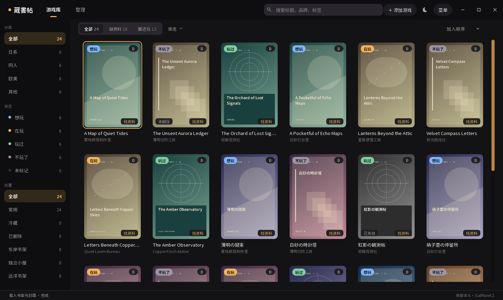
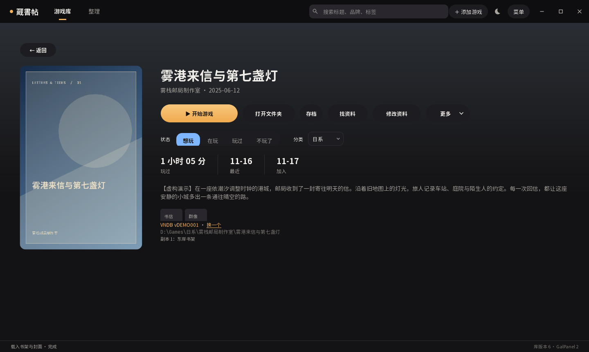
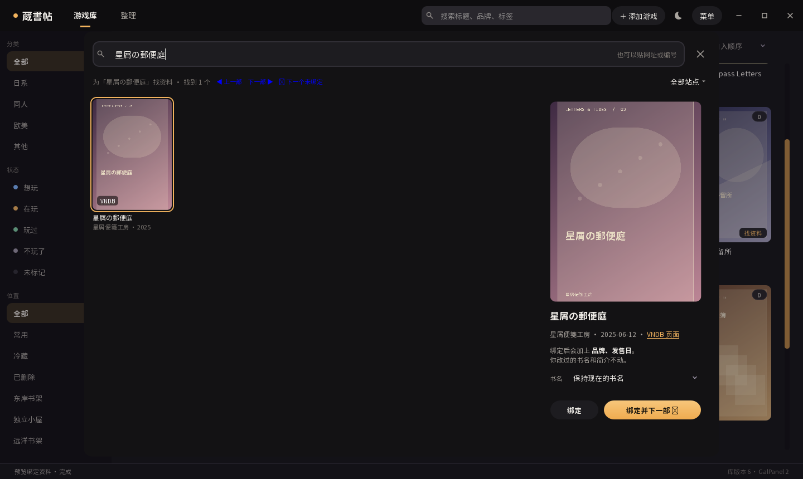
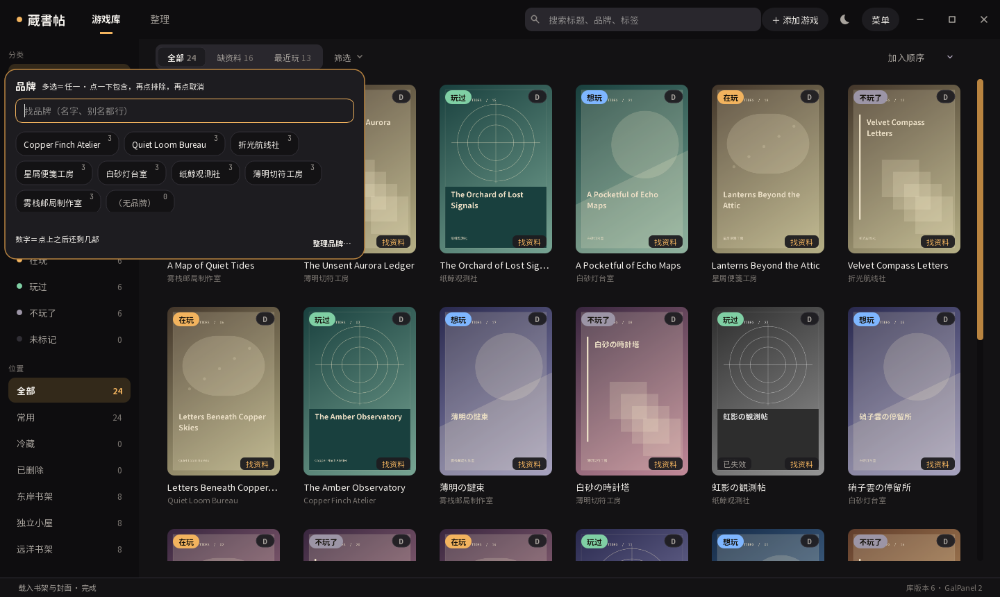
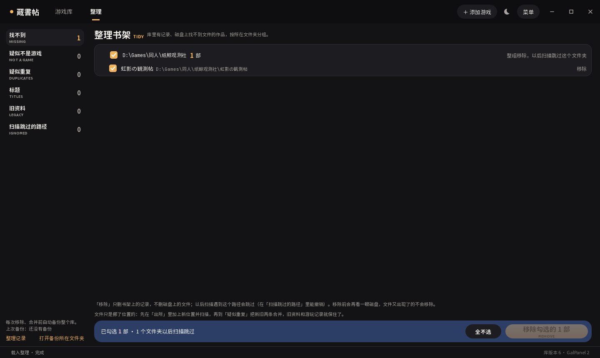
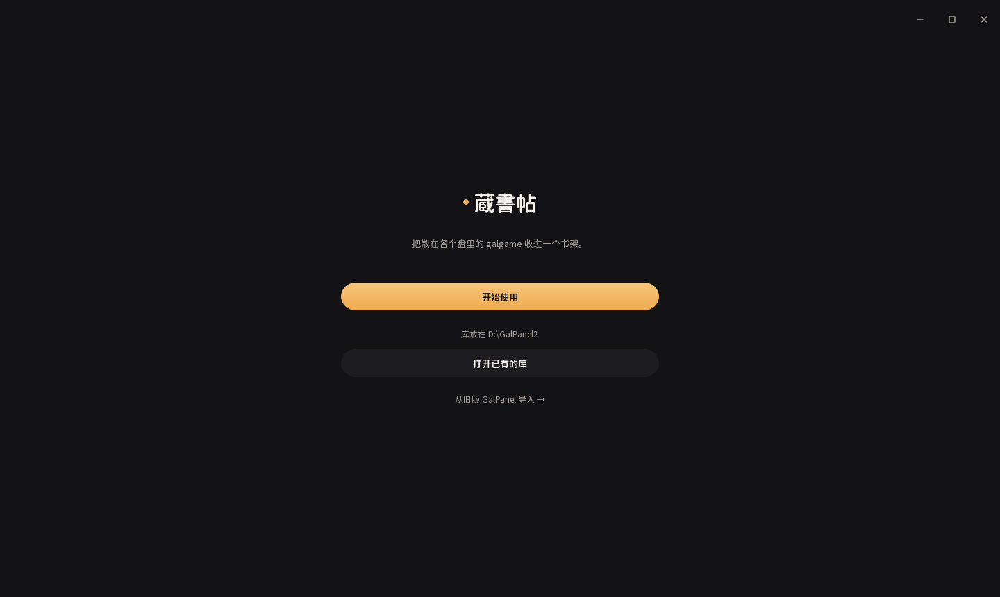

# 蔵書帖 · GalPanel2

GalPanel2 is a Windows desktop library manager for locally owned visual novels and games, with metadata binding and safe JSON CLI / MCP control for AI agents. [English guide](README.en.md).

把散在各个盘里的游戏，收进一个好找、好看的本地书架。



**[下载安装、升级与 AI 接入指南](docs/DEPLOY.md)** · [最新发行版](https://github.com/st666xiao/galpanel2-oss/releases/latest)

支持 Windows，界面以中文为主。软件不附带游戏；截图中的作品、社团、资料编号和封面均为虚构演示。

## 它能做什么

### 海报墙与作品详情

按封面浏览收藏，在详情中查看简介、品牌、标签、游玩记录与文件位置。默认是深色 media 主题，也有日间、夜间主题。



### 多目录，一个书架

在「出所」添加多个磁盘上的游戏目录，扫描后逐项审阅，再确认入库。同一作品可以关联多份副本；移除来源目录会保留已有作品和副本记录。

### 找资料与绑定

点击「找资料」，从 VNDB、DLsite、Bangumi、Steam、F95zone 检索候选，先看预览再绑定。支持标题、品牌、简介、封面及站点标签；站点提供的字段可能不完整，需要人工核对版本。



### 分类、状态与筛选

分类有「日系 / 同人 / 欧美 / 其他」，游玩状态有「想玩 / 在玩 / 玩过 / 不玩了」。通过品牌、标签和文件状态筛选，缩小书架范围。



### 冷藏与整理

通过「冷藏到机械盘…」搬动不常玩的副本。请先在设置中检查冷藏位置，默认示例为 `D:\ColdStorage\Games`。目录整理会先生成计划；「整理」页可检查失效记录、疑似重复等问题，移除或合并前自动备份库。



### 存档导入

详情页「存档」提供 2DFan 存档查找与导入流程，应用前先确认目标位置。存档备份和库备份是两回事：备份库不能代替备份游戏存档。

### AI 识别与 AI 调控

文件夹名称不清楚时，可使用命令行 AI 识别流水线提取线索、生成识别报告；需要自行配置模型服务。JSON CLI 与 MCP 接口还能让 AI 查询书架、预览并应用资料修改。接入方法见下文。

## 快速开始

需要 Windows 10/11 64 位（x64）。安装包自带运行环境，无需 Python。

1. **推荐：下载安装包。** 在 [Releases](https://github.com/st666xiao/galpanel2-oss/releases/latest) 下载 `GalPanel2-Setup-<版本>.exe`，双击按向导安装；默认在 `%LOCALAPPDATA%\Programs\GalPanel2`，无需管理员权限。开始菜单可直接启动，也可选建桌面快捷方式。
2. **一行安装。** 在普通 PowerShell 中执行，自动获取最新正式版、校验 SHA256 后静默安装：

   ```powershell
   irm https://raw.githubusercontent.com/st666xiao/galpanel2-oss/main/install.ps1 | iex
   ```

3. **便携版。** 下载 `GalPanel2-<版本>-win64.zip`，完整解压后双击 `GalPanel2.exe`，保留 `_internal` 目录。也可下载 `install.ps1` 后执行 `.\install.ps1 -Portable -Directory D:\Apps\GalPanel2`，目标目录需不存在或为空。
4. **源码运行。** Windows + Python 3.13，克隆仓库、建 venv 并安装依赖；完整命令见 [部署指南](docs/DEPLOY.md#方式-d源码部署)。

对应 Release 发布后附件才可用；未发布或缺少校验文件时一行安装会停止。升级前先退出程序并备份库，再用新版安装包覆盖安装。安装目录外的库和 `%APPDATA%\GalPanel2` 设置会保留。



SmartScreen、便携升级、卸载与首次建库位置详见 **[部署指南](docs/DEPLOY.md)**。

## 第一次使用

1. 在标题页点「开始使用」，首次会在默认位置建库；已有库可点「打开已有的库」。
2. 进入「出所」，点「添加目录」，选择自己的游戏目录。
3. 选中来源，点「扫描这个目录」。检查「新发现」「同名待判」等条目，确认勾选后点「入库 N 部」（N 为当前数量）。扫描计划生成时还没有写入。
4. 回到书架，打开一部作品，点「找资料」。核对候选与绑定预览后确认；也可从「全部找资料」开始批量检索。
5. 补好分类和游玩状态，再进入「整理」检查问题。涉及搬移或删除游戏文件的操作，请逐项检查确认界面中的路径。

## 数据存放与备份

- 库是你选择的 `.galdb` 文件；默认新库在 `D:\GalPanel2\library.galdb`（存在 D 盘时），否则在设置目录。
- 封面在库旁的 `<库名>.galdb.covers/`。**关闭 GUI 和写入工具后，同时备份库与封面目录**。
- 设置在 `%APPDATA%\GalPanel2\settings.json`，Bangumi token 在同目录 `bangumi_token.txt`。迁移设置时单独保存，勿公开 token。
- 写锁为 `<库名>.galdb.lock`；agent 实际写入前会在库旁生成 `<库>.agent-<UTC>.bak`。待确认的批量资料可能保存在 `<库>.m2queue.json`，也建议保留。
- `GALPANEL2_SETTINGS_DIR` 可覆盖设置目录，`GALPANEL2_DEFAULT_LIBRARY` 可覆盖默认新库路径。
- 游戏和存档在原目录，不包含在 `.galdb` 内。库、封面、游戏和存档分别备份。

## 联网与隐私

普通本地浏览无需联网。资料检索、详情及封面获取、存档查找等操作会请求对应站点；站点可能限频、拒绝访问或需要登录权限。部分站点元数据可能含成人内容。

AI 识别会将提示中的标题和本地识别线索发给你配置的服务或命令。使用前检查配置及线索；不要把凭据写进公开文件。外部命令按当前用户权限运行，其日志与凭据由该命令负责。

## AI 识别配置

没有默认模型或外部命令。配置 OpenAI 兼容服务（PowerShell）：

```powershell
$env:GALPANEL2_AI_BASE_URL="https://api.example.com/v1"
$env:GALPANEL2_AI_MODEL="your-model"
$env:GALPANEL2_AI_API_KEY="你的密钥"
python -m galpanel2.identify --help
```

HTTP 后端请求 `POST {base_url}/chat/completions`。远程端点必须 HTTPS；HTTP 只允许 localhost、127.0.0.1、[::1]。也可保存以下 JSON，通过识别命令的 `--ai-config ai.json` 使用：

```json
{"backend":"openai","base_url":"https://api.example.com/v1","model":"your-model","api_key_env":"GALPANEL2_AI_API_KEY"}
```

配置只写密钥环境变量名，不能写 `api_key`、`key`、`token`。显式配置文件不存在会报错。HTTP 密钥不写入识别产物和日志，不随重定向发送。

可信外部命令也可使用：

```json
{"backend":"command","argv":["your-ai-tool","--prompt","{prompt}","--output","{out}"],"mode":"file","timeout":300}
```

`file` 模式把提示文件路径传给命令，读取 `{out}` 中的 JSON（空文件时可从 stdout 读）；`stdin` 模式从标准输入读提示并向 stdout 输出 JSON。另支持 `{dir}`、`{timeout}`。识别是源码 CLI 功能，发行包提供的三个入口不包含独立 identify EXE。

## AI 调控

默认安装后可运行（便携版替换为实际解压路径）：

```powershell
& "$env:LOCALAPPDATA\Programs\GalPanel2\galpanel2-agent.exe" --library D:\Library\library.galdb list --unbound
& "$env:LOCALAPPDATA\Programs\GalPanel2\galpanel2-mcp.exe" --library D:\Library\library.galdb --lock-library
```

源码对应 `python -m galpanel2.agent` 和 `python -m galpanel2.mcp`。修改默认先预览，真正写入需显式应用，并检查写锁、revision 和备份。客户端配置和完整操作见 [AI 调控与资料绑定指南](docs/AI-CONTROL.md)。

## FAQ

**GUI 开着，agent 为什么只能读？** GUI 持有库的写锁，agent 不能同时写同一个库。关闭 GUI 后再应用修改；不要手动删锁文件绕过检查。

**为什么没有封面？** 扫描本地文件不会凭空获得站点封面。使用「找资料」核对绑定，或在「编辑作品」中选取本地图片；迁移后还要确认 `.galdb.covers` 目录完整。

**资料站限频或没有结果怎么办？** 稍后重试，确认网络、站点可用性和检索词。编号或站点链接可以帮助定位；不要把空结果当成确定不存在。agent 匿名检索不读取 GUI 的 Bangumi token，结果可能不同。

**怎样迁移或恢复库？** 关闭写入工具后，复制 `.galdb` 和对应 `.galdb.covers`；恢复备份时保留当前文件副本，再换回备份。跨电脑或盘符变化时，游戏路径不会自动重写：在「出所」添加新位置并扫描，必要时通过「整理」里的「疑似重复」合并记录，核对旧资料和游玩记录后再处理失效记录。

**「已失效」「未解压」是什么意思？** 前者是登记的文件路径当前不可用，先检查磁盘或路径；后者是只有压缩包，需要自行解压并扫描目录。演示库的空 EXE 只是截图占位，不能玩。

## 开发

```powershell
python -m pip install -r requirements-dev.txt
$env:QT_QPA_PLATFORM="offscreen"
python -m pytest -q
python tools/make_demo_library.py --out C:\Temp\gp2-demo
python tools/take_screenshots.py --demo C:\Temp\gp2-demo
python -m PyInstaller --clean --noconfirm packaging/galpanel2.spec
```

生成器要求全新或空目录，不覆盖已有库；演示源路径依赖 Windows。截图走本地虚构回放，不请求真实站点。截图 workflow 手动触发后下载 artifact，人工检查图片再提交。

Release workflow 在 Windows 运行测试与构建；手动触发上传安装包、便携 zip 与 `SHA256SUMS.txt` artifact，推送匹配项目版本的 `v*` 标签才发布。详见 [贡献指南](CONTRIBUTING.md) 和 [更新记录](CHANGELOG.md)。

## 许可

代码采用 [MIT](LICENSE)。界面素材由项目作者用 AI 生成，随项目以 MIT 发布，见 [素材来源](assets/SOURCES.md)。内置字体各自采用 SIL OFL，许可位于 [字体目录](galpanel2/resources/fonts)。站点元数据、封面和用户游戏文件的权利归各自权利人。
